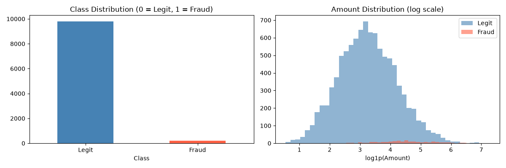
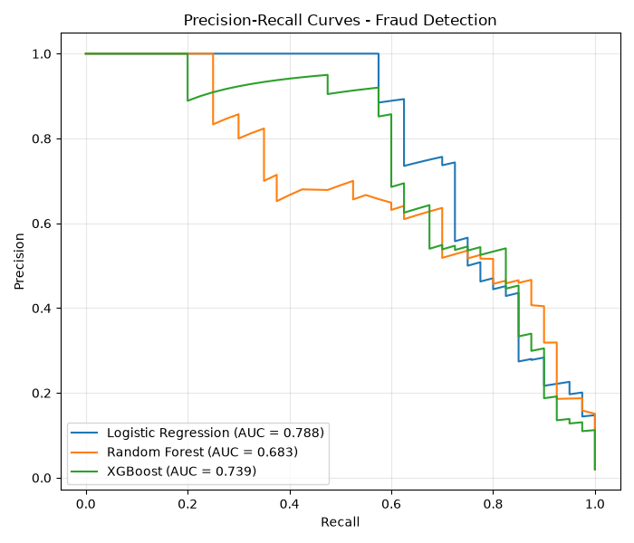

# 💳 Credit Card Fraud Detection

[](https://www.python.org/)
[](https://xgboost.readthedocs.io/)
[](LICENSE)

Detect fraudulent credit card transactions in a heavily imbalanced dataset (~2% fraud).
Complete pipeline: EDA → scaling → **SMOTE** → model comparison → PR-AUC evaluation.

## 🚀 Quick Start

```bash
pip install -r requirements.txt
python fraud_detection.py
```
Plots are saved into `images/` automatically. Runs out of the box with realistic synthetic
imbalanced data — to use the real Kaggle *Credit Card Fraud Detection* dataset instead,
uncomment the **Option B** block in `fraud_detection.py`.

## 🛠️ Pipeline
1. **EDA** — class imbalance ratio, legit vs fraud amounts (log scale)
2. **Scaling** — `StandardScaler`
3. **SMOTE** (`imblearn.over_sampling.SMOTE`) — synthetic minority samples via k-NN interpolation.
   Applied to the **training set only** — resampling the test set would leak information.
4. **Models** — Logistic Regression · Random Forest · XGBoost
5. **Evaluation** — Precision, Recall, F1, **PR-AUC** + precision-recall curves

## ❓ Why PR-AUC (not ROC-AUC)?
With 98% legitimate transactions, a do-nothing model scores 98% accuracy and a deceptive
ROC-AUC. PR-AUC focuses on the rare fraud class and reflects real performance.

## 📊 Results (synthetic data)
| Model | Precision | Recall | F1 | PR-AUC |
|---|---|---|---|---|
| Logistic Regression | 0.26 | 0.90 | 0.40 | 0.789 |
| XGBoost | 0.55 | 0.68 | 0.61 | 0.741 |
| Random Forest | 0.58 | 0.70 | 0.64 | 0.685 |

> Tune the decision threshold (default 0.5) based on the business cost of a missed fraud
> vs a wrongly blocked legitimate customer.

## 🖼️ Plots



## 🔗 Dataset (real)
Kaggle → *Credit Card Fraud Detection* (`creditcard.csv`; `Time`, `V1..V28`, `Amount`, `Class`)

## 📄 License
MIT — see [LICENSE](LICENSE). Part of my [ML portfolio](https://github.com/rajwardeep7-wq).
